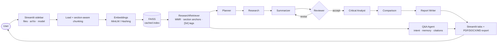

# Autonomous AI Research Agent — AI that Summarizes Research Papers

> A team of LangGraph agents reads research papers, writes **cited** summaries, **checks its own work**, critiques the research, compares papers and answers follow-up questions — with or without an API key.

    

Final AI Capstone Project · Akshay Kale

---

## Overview

Researchers, students and reviewers spend hours reading papers to answer simple questions: *What problem does it solve? What did they actually measure? Can I trust the numbers? How does it compare with that other paper?*

This project automates that first pass. You upload papers (or give an arXiv ID) and a multi-agent workflow — **Planner → Research → Summarizer → Reviewer → Critical Analyst → Comparison → Report Writer**, built as a LangGraph state graph — produces:

- an 8-section structured summary of each paper, where **every bullet carries a citation tag** (`[S2]`) that links back to a file, page and section;
- a **quality score** from a Reviewer agent that checks coverage, citation grounding and whether every number in the summary really appears in the paper — and sends the summary back for revision when it doesn't;
- a critical analysis (contributions, strengths, weaknesses, novelty, applications, open questions), a tone analysis and key terms;
- a cross-paper comparison when two or more papers are loaded;
- a downloadable research brief (PDF; DOCX and Markdown exporters are also included);
- a chat tab for follow-up questions (conversational RAG with memory, intent routing and per-paper filtering), which can also *create* material such as interview questions or a quiz from the papers.

The whole system runs **offline with no API key** using a built-in extractive model, and switches to OpenAI GPT, Llama 3 (Groq) or Google Gemini when a key is provided.

## Problem Statement

Summarizing a scientific paper with a large language model sounds easy, but three problems make naive approaches unreliable:

1. **Long documents don't fit.** A paper is longer than most context windows, so the model only sees part of it. Plain "top-k chunk" retrieval tends to return several chunks from the introduction and miss the results or limitations.
2. **Hallucination is unacceptable.** A summary that invents a dataset or a percentage is worse than no summary. Readers need to see *where* each claim came from.
3. **One prompt does too much.** Retrieval, summarizing, fact-checking and critique in one prompt make errors impossible to trace or fix.

**Goal:** build an autonomous, auditable assistant that covers every part of a paper, grounds every statement in a cited passage, verifies its own output before showing it, and still works on a laptop without paid APIs.

## Features

| Area | What it does | Where in `app.py` |
|---|---|---|
| **Multi-format ingestion** | PDF, Word (.docx), PowerPoint (.pptx), Excel (.xlsx), CSV, TXT, Markdown; fetch PDFs directly from arXiv by ID or URL | §6 |
| **Paper understanding** | Extracts title, authors, abstract and section headings; detects numbered, ALL-CAPS and Word/slide headings | §6 |
| **Section-aware chunking** | `RecursiveCharacterTextSplitter` (1,000 chars, 150 overlap); every chunk keeps file, page, section(s) and a stable chunk ID | §6 |
| **Vector search** | FAISS with MMR or similarity search, per-paper filtering, section-aware anchor retrieval and multi-query de-duplication | §7–8 |
| **Index caching** | FAISS index saved to disk under a SHA-256 key of file contents + chunk settings + embedding model — re-uploads skip re-embedding | §7 |
| **Resilient embeddings** | `all-MiniLM-L6-v2` (384-d, CPU); falls back automatically to `HashingEmbeddings` when the model can't be downloaded | §5 |
| **4 LLM back-ends** | OpenAI, Groq (Llama 3), Google Gemini, and an **offline extractive model** (TF-IDF centrality + section cue words) that needs no key | §4 |
| **Live model discovery** | After a key is entered, the app asks the provider which chat models that key can use | §4 |
| **7-step agent workflow** | LangGraph `StateGraph` with conditional routing and an append-only execution trace | §15 |
| **Self-reflection loop** | Reviewer scores the summary and loops back to the Summarizer with written feedback (bounded by `MAX_REFLECTION_LOOPS`) | §12, §15 |
| **Hallucination guard** | Any number in a summary that does not appear in the source evidence fails the review, regardless of score | §12 |
| **Critical analysis** | Contributions, strengths, weaknesses, novelty, applications, open questions + lexicon-based tone and hedging analysis | §13 |
| **Comparison** | Common themes, key differences, method and result comparison, recommended reading order | §13 |
| **Chat with the papers** | Intent router (9 intents), paper detection by name/title/acronym, query condensing from chat memory, cited answers | §16 |
| **"Create" requests** | Interview/viva questions with model answers, quizzes, explanations, drafts — facts still cited | §16 |
| **Report export** | PDF (ReportLab), DOCX (python-docx) and Markdown, including quality scores and a full source list | §17 |
| **Production touches** | LLM response cache (SQLite), retries with exponential back-off, plain-English provider errors, rotating log file, Streamlit Secrets support | §2, §4, §9, §19 |

## Technologies Used

| Layer | Technology | Purpose |
|---|---|---|
| Language | Python 3.13 | — |
| LLM framework | LangChain 1.4 (`langchain-core`, `langchain-community`, `langchain-text-splitters`) | prompts, LCEL chains (`prompt \| llm \| parser`), loaders, splitter |
| Agent orchestration | LangGraph 1.2 | state graph, conditional edges, streaming updates |
| LLMs | OpenAI GPT (`gpt-4o-mini` default), Llama 3 via Groq (`llama-3.1-8b-instant`), Google Gemini (`gemini-3.1-flash-lite`), offline extractive model | generation |
| Embeddings | sentence-transformers `all-MiniLM-L6-v2` via `langchain-huggingface`; scikit-learn `HashingVectorizer` fallback | semantic vectors |
| Vector store | FAISS (`faiss-cpu`) | similarity / MMR search |
| NLP utilities | scikit-learn TF-IDF, NumPy, regex-based sentence splitting | offline summarizer, keywords, tone |
| Documents | pypdf, python-docx, python-pptx, openpyxl, pandas | input parsing |
| Reporting | ReportLab, python-docx | PDF / DOCX export |
| UI | Streamlit 1.66 | web app |
| Config & ops | python-dotenv, Python `logging` (rotating file), SQLite LLM cache | settings, observability, cost control |

## Project Architecture




The full Mermaid source is in [`architecture.mmd`](architecture.mmd).

**How a run flows**

1. **Ingest** — each file is parsed, cleaned and split into chunks that remember their page and section. Chunks are embedded and stored in FAISS (or loaded from the on-disk cache).
2. **Plan** — the Planner decides the steps (comparison only when there are 2+ papers).
3. **Research** — for each paper, the Research Agent takes one anchor chunk from each canonical section (introduction, method, experiments, results, limitations, conclusion), then runs six aspect queries with MMR. With an LLM, it also writes three paper-specific search queries from the abstract (query expansion). The abstract is always included as `[S0]`.
4. **Summarize** — the Summarizer fills 8 fixed headings (TL;DR, Problem Statement, Methodology, Datasets and Experiments, Key Findings, Limitations, Future Work, Keywords), citing every bullet.
5. **Review** — the Reviewer computes `score = 0.40·coverage + 0.35·grounding + 0.25·faithfulness`. Below 0.70, or if any number is unsupported, it sends a list of concrete issues back to the Summarizer.
6. **Analyze → Compare → Report** — critique, comparison and the closing brief are written from the reviewed summaries.
7. **Chat** — questions are routed by intent, optionally limited to the paper they mention, rewritten using chat history, and answered with citations.

## Installation Steps

```bash
# 1. Get the code
git clone <your-repository-url> Final_Capstone_Project
cd Final_Capstone_Project

# 2. Create and activate a virtual environment (Python 3.11+; tested on 3.13)
python -m venv .venv
source .venv/bin/activate          # Windows: .venv\Scripts\activate

# 3. Install dependencies
python -m pip install --upgrade pip
python -m pip install -r requirements.txt

# 4. (Optional) add an API key
cp .env.example .env               # Windows: copy .env.example .env
# then edit .env, e.g. LLM_PROVIDER=OpenAI and OPENAI_API_KEY=sk-...
```

No key? Skip step 4 — the app runs on the offline model.

## Requirements

- Python 3.11 or newer (developed and tested on 3.13)
- ~2 GB free disk for PyTorch + the embedding model (first run downloads `all-MiniLM-L6-v2`, ~90 MB)
- 4 GB RAM is enough for papers of normal length; no GPU needed
- Internet only for: the first embedding-model download, arXiv fetches and cloud LLMs (offline mode + `hashing` embeddings need none)
- Optional API key for one provider: `OPENAI_API_KEY`, `GROQ_API_KEY` or `GOOGLE_API_KEY`

All Python packages with pinned versions are in [`requirements.txt`](requirements.txt). The pinned set installs cleanly into a fresh environment (`pip check`: no broken requirements).

## Running Jupyter Notebook

```bash
source .venv/bin/activate
python -m ipykernel install --user --name research-agent --display-name "Research Agent (.venv)"
python -m pip install notebook      # only if Jupyter isn't installed already (VS Code needs just ipykernel)
jupyter notebook project.ipynb      # or open it in VS Code / JupyterLab
```

Select the **Research Agent (.venv)** kernel and run the cells top to bottom. The notebook walks through the same sections as `app.py` — configuration, loading and chunking, embeddings and FAISS, each agent, the LangGraph workflow, evaluation and results. In code, everything goes through one facade:

```python
from app import ResearchPipeline, Settings

pipe = ResearchPipeline(Settings(llm_provider="Offline (Extractive demo)"))   # or "OpenAI", api_key="sk-..."
pipe.ingest(["sample_papers/01_hirag_hierarchical_retrieval.pdf",
             "sample_papers/02_agentic_literature_review.pdf"])
state = pipe.run_agents("Detailed")          # Plan → Research → Summarize → Review → Analyze → Compare → Report
print(state["report"].reviews)               # coverage / grounding / faithfulness per paper
print(pipe.ask("What dataset was used in HiRAG?").answer)
open("outputs/report.pdf", "wb").write(pipe.export(state["report"], "pdf"))
```

## Running Streamlit Application

```bash
source .venv/bin/activate
streamlit run app.py
```

Open http://localhost:8501, then either click **▶ Play with sample papers**, or upload your own files / enter an arXiv ID in the sidebar and press **Process papers**. The *Episodes* row in the header fills in as each agent finishes.

To deploy on Streamlit Community Cloud, add `LLM_PROVIDER` and the matching API key under **App settings → Secrets**; visitors then use the owner's model without entering a key.

## Sample User Inputs

| Input | Example |
|---|---|
| Upload | `sample_papers/01_hirag_hierarchical_retrieval.pdf` and `02_agentic_literature_review.pdf` (included) |
| arXiv ID | `1706.03762` (*Attention Is All You Need*) or a full `https://arxiv.org/abs/...` URL |
| Summary style | Detailed · Concise · Beginner-friendly |
| Chat — fact | *What dataset was used in HiRAG?* |
| Chat — section | *What are the limitations of AgentReview?* |
| Chat — comparison | *Compare the results* |
| Chat — metadata | *Who wrote the AgentReview paper?* |
| Chat — create | *Give me interview questions and answers about this research* |

## Expected Outputs

Results below are from a real end-to-end run of this code on the two sample papers (offline model, so no API cost).

**Ingestion** — 2 papers · 4 pages · 948 words · 9 chunks indexed; section headings detected: Abstract, Introduction, Method/Approach, Experimental Setup/Evaluation, Results, Limitations, Conclusion. Titles and author lines extracted correctly for both papers.

**Agent workflow** — all 7 steps complete; Reviewer score **1.00** for both papers (coverage 1.00, grounding 1.00, faithfulness 1.00).

**Summary (excerpt, HiRAG)**

> **Key Findings**
> - HiRAG achieves a ROUGE-L of 41.3 compared with 37.2 for flat retrieval. `[S2]`
> - Unsupported numerical claims fell by 37% compared with the baseline. `[S2]`

**Chat**

| Question | Routed intent / paper | Answer (first bullet) |
|---|---|---|
| What dataset was used in HiRAG? | `data` / HiRAG | We collected 1,200 computer-science papers from arXiv published between 2019 and 2024. `[S2]` |
| Who wrote the AgentReview paper? | `authors` / AgentReview | S. Banerjee, P. Kowalski and M. Ortega — Agricultural AI Lab `[S1]` |
| Compare the results | `comparison` / all papers | Balanced retrieval from both papers, each claim cited |

**Report** — PDF (≈17 KB), DOCX (≈40 KB) and Markdown (≈16 KB) generated, each containing the executive summary, per-paper findings and analysis, quality scores, comparison, recommendations, conclusion and every source with page and section.

With a cloud LLM the summaries become abstractive (rewritten rather than selected sentences), the Research Agent adds query expansion, and chat follow-ups are rewritten using conversation history.

## Screenshots Section

| | |
|---|---|
|  **Home** — billboard header, 7 agent "episodes", sidebar settings |  **Run complete** — every agent finished, papers shown with their grounding score |
|  **Summaries** — cited 8-section summary with Reviewer scores and key terms |  **Critical analysis** — tone gauge, strengths, weaknesses |
|  **Ask the papers** — cited answer, detected intent and target paper |  **Comparison** — themes, differences, reading order |
|  **Report** — executive summary, recommendations, PDF download |  **Agent trace** — every step with timing |

## Project Structure

```
Final_Capstone_Project/
├── app.py                     # complete application: pipeline, agents, LangGraph workflow, Streamlit UI (19 sections)
├── project.ipynb              # step-by-step notebook: problem, data processing, model, testing, evaluation, results
├── requirements.txt           # pinned dependencies (tested, conflict-free)
├── README.md
├── .env.example               # all settings and API-key variables, documented
├── .gitignore
├── report.pptx                # 15-slide final presentation with speaker notes
├── architecture.png           # system architecture diagram
├── architecture.mmd           # Mermaid source of the architecture
├── docs/
│   ├── EXECUTION_GUIDE.md     # setup, API keys, running, troubleshooting
│   ├── VIVA_QUESTIONS.md      # 60 viva questions with answers
│   ├── architecture.dot       # Graphviz source of architecture.png
│   └── make_samples.py        # regenerates the two sample papers
├── sample_papers/             # 2 demo papers used by "Play with sample papers"
├── screenshots/               # 8 screenshots of the running app
├── outputs/                   # sample generated report (PDF + Markdown)
└── data/                      # uploads/, vector_store/ (FAISS cache), cache/ (LLM cache) — filled at runtime
```

Detailed setup and troubleshooting: [`docs/EXECUTION_GUIDE.md`](docs/EXECUTION_GUIDE.md).

## Future Improvements

1. **Claim-level fact checking.** The Reviewer checks that numbers appear in the evidence, but by string match — `12` is "found" inside `1,200`. Next step: match numbers with their units and context, and add an NLI/entailment check per bullet.
2. **Retrieval evaluation set.** Build a labelled question set over 20–30 real arXiv papers and track Recall@k, MRR and answer faithfulness (e.g. RAGAS) for MMR vs similarity and different chunk sizes.
3. **Hybrid search + re-ranking.** Combine BM25 with dense vectors and add a cross-encoder re-ranker to improve precision on exact terms like dataset names.
4. **OCR for scanned PDFs.** Today they are rejected with a clear message; Tesseract or a vision model would make them usable.
5. **Tables and figures.** Parse result tables into structured data so the Analyst can compare numbers across papers directly.
6. **Parallel agents.** Run per-paper research and summarization concurrently (LangGraph `Send` / async) to cut wall-clock time for large batches.
7. **Persistent sessions.** Save libraries and chat history per user (SQLite/Postgres + LangGraph checkpointer) instead of per browser session.
8. **All export formats in the UI.** The DOCX and Markdown exporters exist in code; expose them as download buttons alongside PDF.
9. **Citation-graph discovery.** Use the Semantic Scholar API to suggest related papers and fetch them automatically.
10. **Containerised deployment.** Dockerfile + CI tests for the loader, reviewer and router.

## Author Information

**Akshay Kale**
Final AI Capstone Project — *Autonomous AI Research Agent: AI that Summarizes Research Papers*
Email: akshaykale3@gmail.com

---

<sub>Sample papers in `sample_papers/` are short synthetic papers written to demonstrate the system; their numbers are illustrative, not real research results.</sub>
